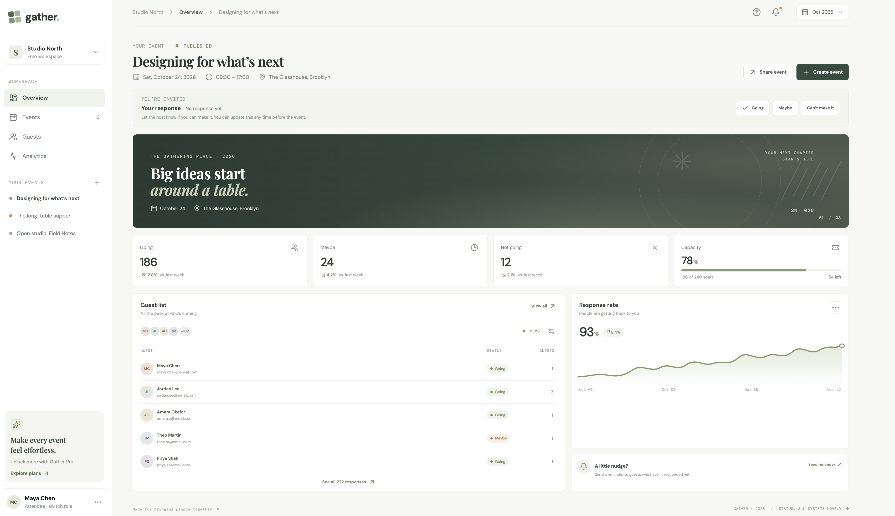
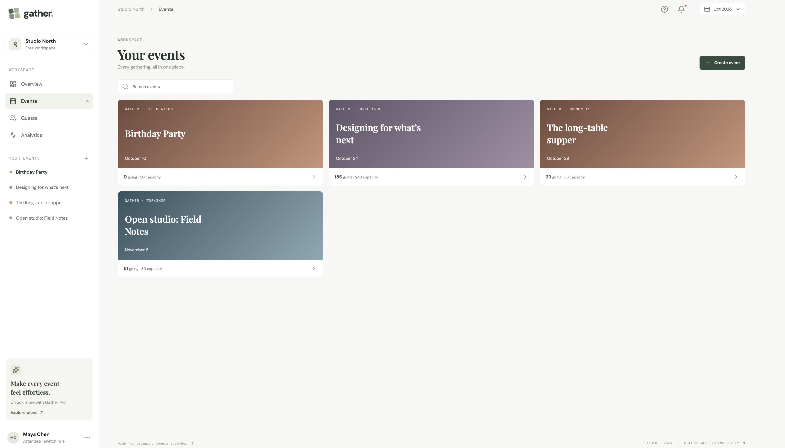
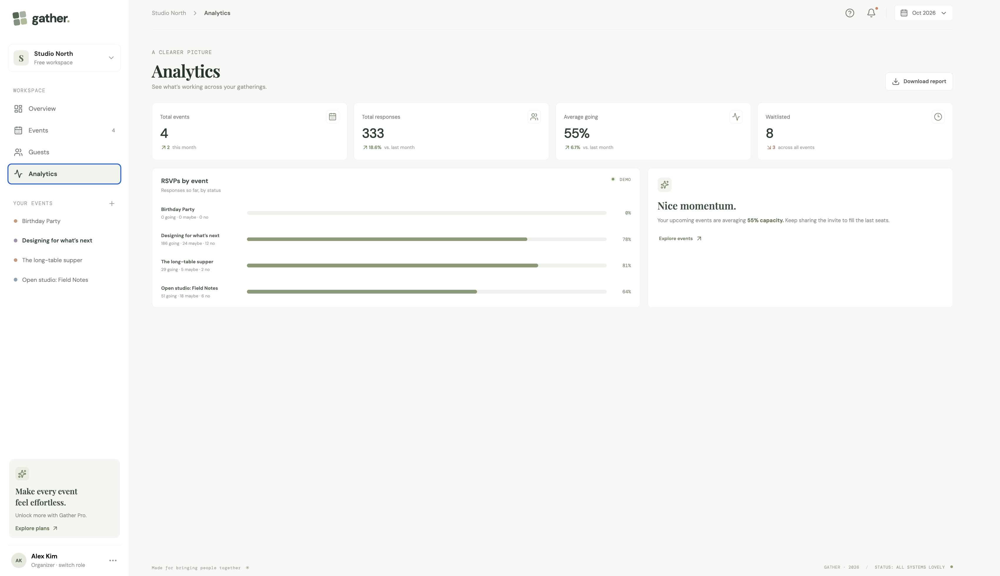
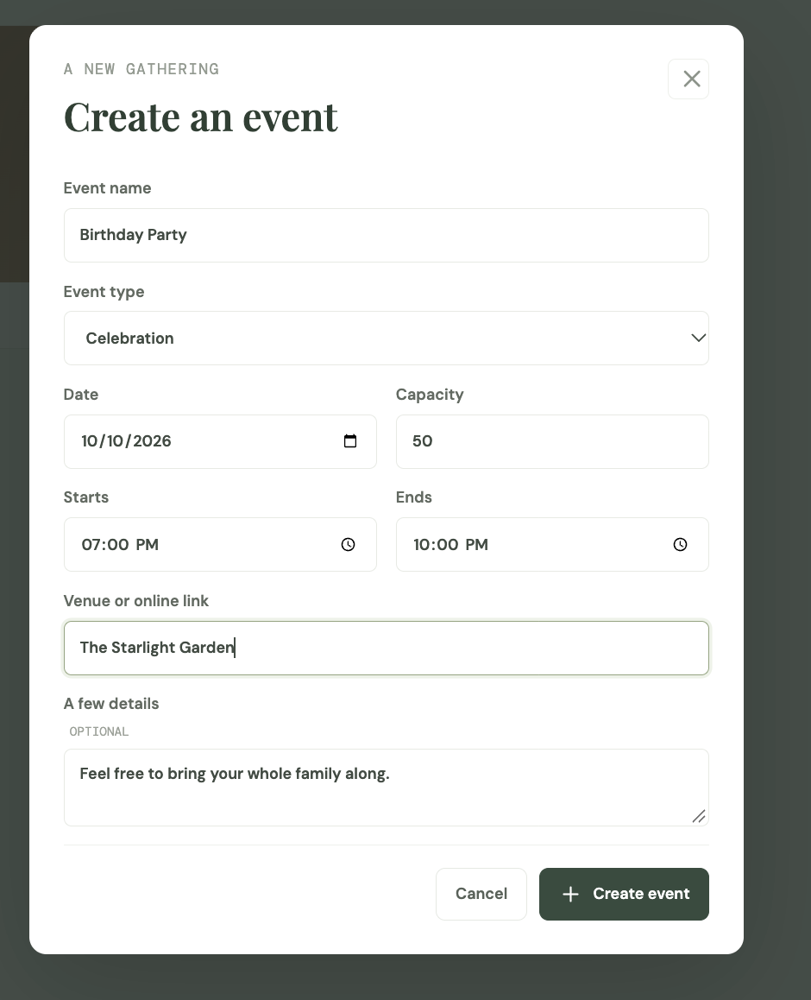
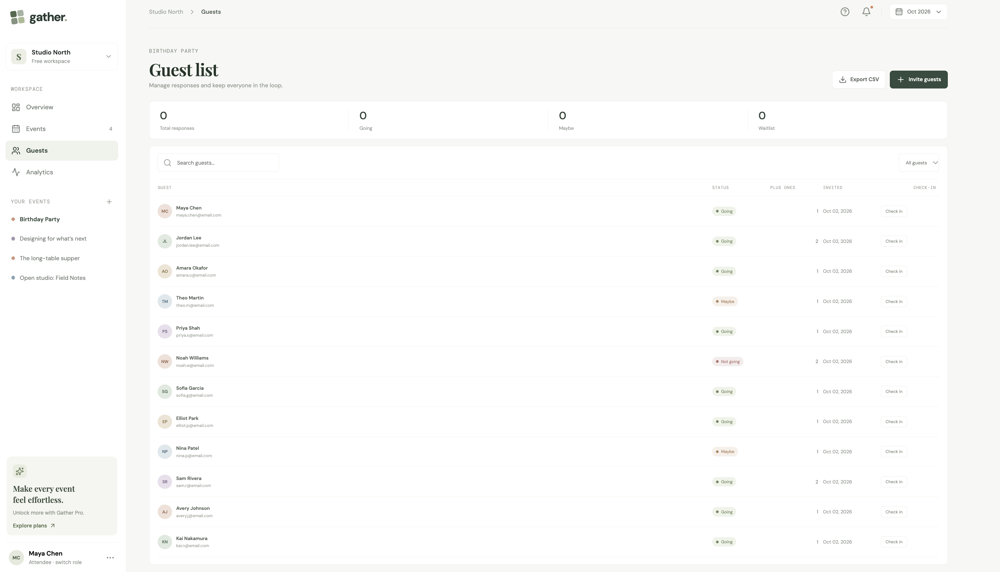
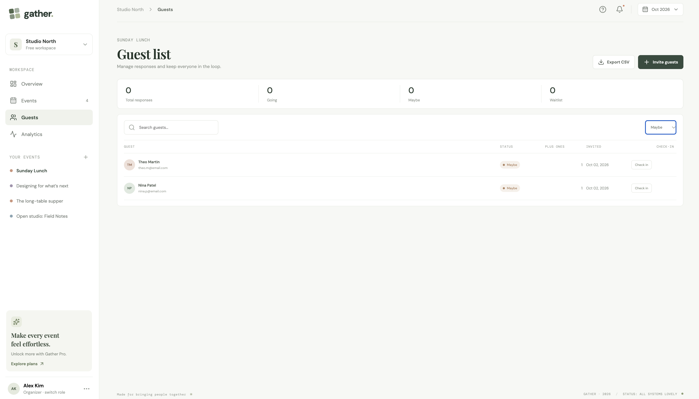
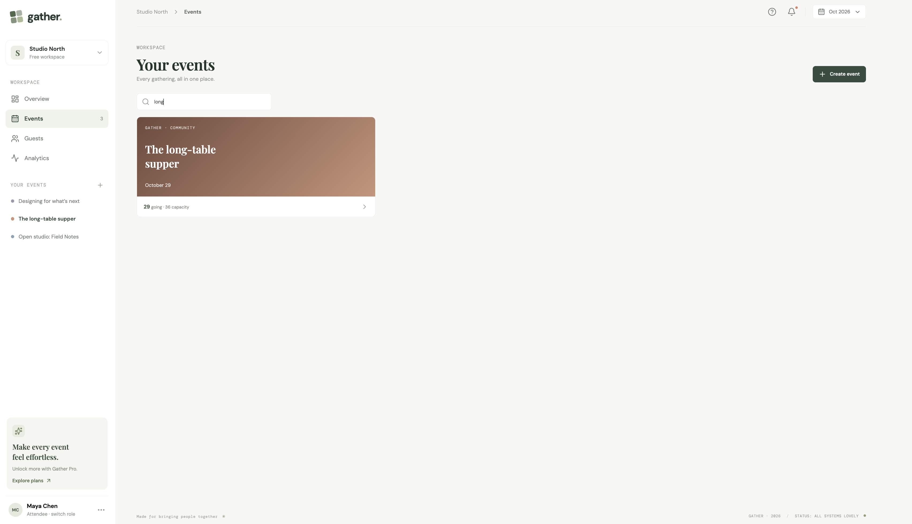
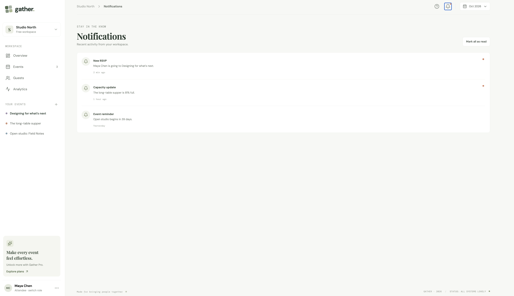
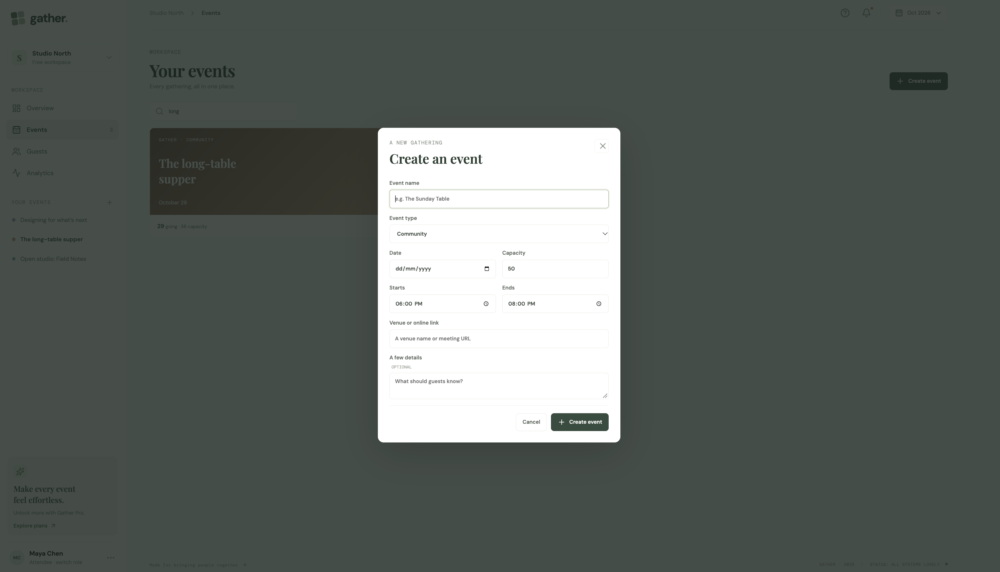
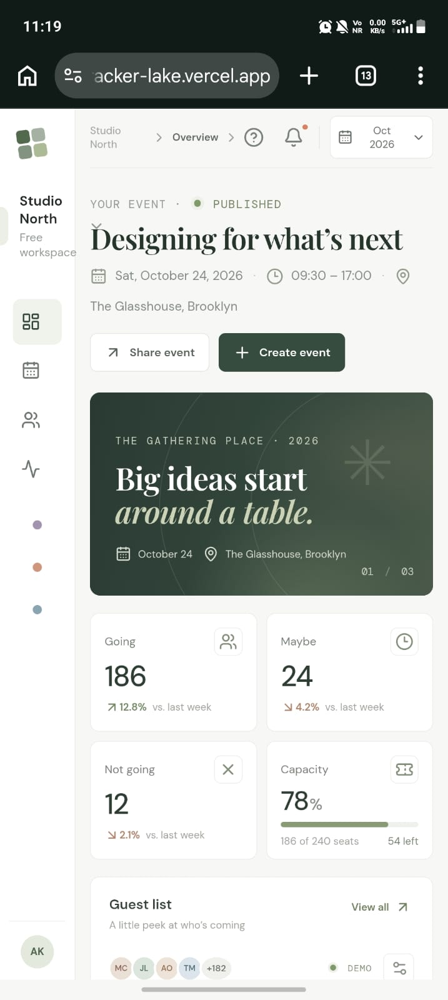

# Gather — Real-Time Cloud-Based Event Planning & RSVP Tracker

**Live demo:** https://real-time-cloud-event-rsvp-tracker-lake.vercel.app/

A student project exploring event coordination, RSVP integrity, capacity management, attendee check-in, and cloud architecture. The runnable demo is a polished single-page React app, hosted on Vercel, that persists synthetic demo data in the browser. It works without cloud credentials.

> **Demo scope:** browser local storage is not a cloud database, the organizer/attendee switch is not authentication, and the "live" indicators reflect local state only. The secure, cloud-backed design is documented below and is the planned next step.

## Contents

- [Screenshots](#screenshots)
- [Features](#features-in-the-runnable-demo)
- [Tech stack](#tech-stack)
- [Run locally](#run-locally)
- [Testing](#testing)
- [Deployment](#deployment)
- [Cloud architecture and production boundary](#cloud-architecture-and-production-boundary)
- [Secure production RSVP flow](#secure-production-rsvp-flow)
- [Edge-case test coverage](#edge-case-test-coverage)
- [Cloud concepts shown in the design](#cloud-concepts-shown-in-the-design)
- [Repository structure](#repository-structure)
- [Limitations and next steps](#limitations-and-next-steps)
- [Author](#author)

## Screenshots

All screenshots use synthetic demo data.

| Event dashboard                                    | Your events                                                                 |
| -------------------------------------------------- | --------------------------------------------------------------------------- |
|  |  |

| Analytics                                         | Create an event                                                      |
| ------------------------------------------------- | -------------------------------------------------------------------- |
|  |  |

| Guest list                                                                      | Guest list filtered by status                                                    |
| ------------------------------------------------------------------------------- | -------------------------------------------------------------------------------- |
|  |  |

| Event search                                            | Notifications                                            |
| ------------------------------------------------------- | -------------------------------------------------------- |
|  |  |

| Create event (empty form)                                      | Mobile view                                                    |
| -------------------------------------------------------------- | -------------------------------------------------------------- |
|  |  |

## Features in the runnable demo

- Organizer and attendee view switcher (demo only; it is not authentication).
- Seeded synthetic events, dashboards, response analytics, activity notices, and sample guests.
- Event creation with input validation for dates/times, capacity bounds, title, and venue.
- RSVP responses for Going, Maybe, and Not going, capacity handling, waitlist count, and response changes.
- Event search, guest search, and guest status filters.
- CSV export and simulated check-in.
- Saved state across page refreshes (browser local storage).
- Responsive desktop and mobile layouts.

### Attendee demo mode

Use the profile switcher in the lower-left corner to switch to the synthetic attendee view and submit a local Going / Maybe / Not going response. The response is saved only in this browser's local storage; the dashboard is seeded sample data and does not synchronize to other people. This is for interaction demonstration, not real invitations or cloud authentication.

## Tech stack

- **Frontend:** React and Vite
- **Icons:** lucide-react
- **Testing:** Vitest with jsdom
- **Hosting:** Vercel (static Vite build served from its CDN)
- **Planned backend:** Firebase Authentication, Firestore, and Cloud Functions (see below)

## Run locally

Requirements: Node.js 20 or newer (a current LTS such as 22 or 24 is recommended) and npm.

```bash
git clone https://github.com/srahul22696/Real-Time-Cloud-Event-RSVP-Tracker.git
cd Real-Time-Cloud-Event-RSVP-Tracker
npm install
npm run dev
```

Open the URL printed by Vite (usually `http://localhost:5173`).

| Command           | What it does                           |
| ----------------- | -------------------------------------- |
| `npm run dev`     | Start the development server           |
| `npm run build`   | Create the production build in `dist/` |
| `npm run preview` | Serve the production build locally     |
| `npm test`        | Run the automated edge-case tests      |

## Testing

```bash
npm test
```

The suite runs 7 automated tests over the pure event, RSVP, and capacity logic in `src/domain.js`. See [Edge-case test coverage](#edge-case-test-coverage) for what they check.

## Deployment

The demo is deployed on Vercel as a static Vite site. To deploy your own copy:

1. Push the repository to GitHub.
2. In Vercel, choose **Add New → Project** and import the repository.
3. Use the **Vite** framework preset with build command `npm run build` and output directory `dist`.
4. Deploy. No environment variables are needed for the local-storage demo.

`vercel.json` rewrites every route to `index.html` so refreshing the page on any URL still loads the single-page app.

For production Firebase integration, configure Firebase IDs as Vercel environment variables and add the trusted backend, Firestore rules and indexes, and the Firebase app-domain allowlist before deployment. Never put service account keys or admin credentials in frontend variables.

## Cloud architecture and production boundary

The deployable client build is hosted on Vercel as a static Vite site. A production system should use Firebase Authentication, Firestore, and callable Cloud Functions (or a trusted API) for sensitive operations:

```text
Browser (React/Vite) → Firebase Auth → Callable API / Cloud Functions
                                         ├─ Firestore transaction (invite token + RSVP + capacity + waitlist)
                                         ├─ Firestore snapshots (authorized live dashboard)
                                         └─ notification provider (optional)
                               Vercel CDN serves static client assets
```

The current repository does **not** contain a Firebase project binding, deployed API, database security rules, authentication, or server-side RSVP transactions. Do not enter real personal data; use the provided synthetic records. Browser storage and a client-side role switch cannot provide authentication, authorization, global synchronization, or race-safe capacity across users. The RSVP capacity helper demonstrates expected decisions but is not a substitute for a server transaction.

## Secure production RSVP flow

1. Authenticate the organizer with Firebase Auth and check ownership/role in trusted backend code.
2. Generate invite tokens with a cryptographic random generator; store a hash of each token and validate token length/format, event state, expiry/deadline, and one-time/idempotency key server-side.
3. A callable function verifies the invite and validates status enum, integer guest count, `plusOnesAllowed`, and registration deadline.
4. In one Firestore transaction, read event capacity and current invite/RSVP, account for the invite's previous response, allocate the remaining seats, update RSVP/invite and aggregate counts, or queue the invite FIFO. This avoids check-then-write races.
5. Restrict client reads to the event owner and public-safe fields; deny direct client writes to private invites, RSVP aggregates, and check-ins. Validate every request server-side and rate-limit token submissions.
6. Firestore listeners stream authorized aggregate updates. A reconnecting client obtains a fresh snapshot; writes use idempotency keys to make retry safe.

Production invite tokens must never be logged or exposed in analytics. Avoid collecting more attendee contact data than needed. Add rules/functions emulator tests before using real guests.

## Edge-case test coverage

The tests cover malformed/unusual capacities, invalid calendar input, reversed event times, whitespace normalization, forged RSVP states, negative/fractional/oversized guest counts, invite allowance, expired deadlines, full capacity, last-seat allocation, and editing an existing Going response.

## Cloud concepts shown in the design

- **SaaS:** hosted event coordination delivered through a browser.
- **PaaS/serverless:** Vercel static hosting and Firebase managed auth/database/functions in the target architecture.
- **Real-time:** Firestore snapshot listeners in the production design; the local demo is browser-local only.
- **REST/API:** callable API boundary for token RSVP and organizer actions.
- **RBAC:** organizer/attendee roles must be enforced by verified claims and backend ownership checks; the demo switch is cosmetic.
- **Scalability and failure handling:** managed static CDN, transactions, idempotency, listener reconnection, bounded retries, and server-side rate limits are planned production controls.

## Repository structure

```text
src/main.jsx         React application and local demo
src/domain.js        Pure event, RSVP, and capacity validation
src/domain.test.js   Edge-case tests
src/styles.css       Responsive interface
docs/screenshots/    Screenshots used in this README
index.html           Vite entry page
vercel.json          SPA route rewrite for Vercel
package.json         Scripts and dependencies
```

## Limitations and next steps

- Connect Firebase Auth, Firestore listeners, transactional Cloud Functions, and security rules.
- Add invite-token creation and QR generation, real notifications, and authorized staff check-in.
- Add Functions/emulator integration tests and end-to-end browser tests before claiming cloud authentication or concurrency safety.
- Refresh the synthetic seeded dates for a real deployment.

## Author

Built by **Rahul Singh** — [github.com/srahul22696](https://github.com/srahul22696)
